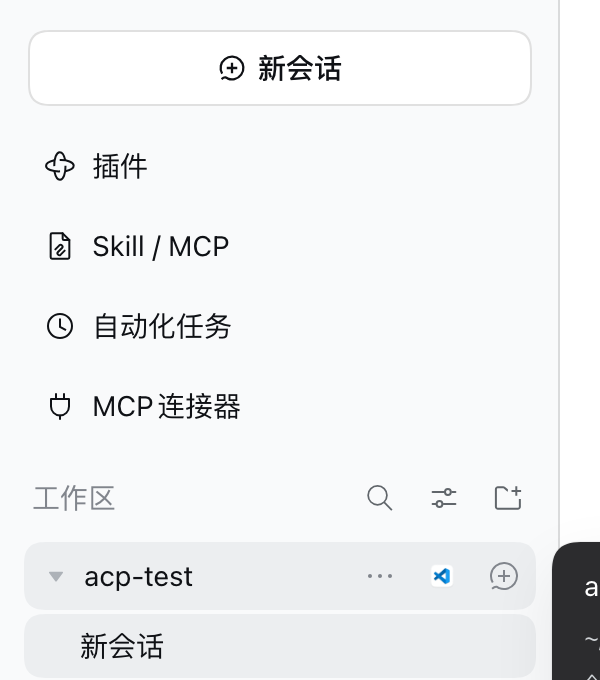

# dsh-workspace-open-in-editor

给 DSH Web 侧栏的**每个工作区行**加一个「在编辑器中打开」按钮：点一下就用 VS Code（或 Cursor）打开这个工作区对应的项目目录，不必先切进某个会话。

```
[▾ acp-test]   …   [⧉]   ⊕
                     ↑
              新增的按钮（悬停时出现）
```



## 行为

| 操作 | 结果 |
|---|---|
| 单击 | 用记住的编辑器打开该工作区的目录（首次是 VS Code） |
| ⌥/Option + 单击 | 换另一个编辑器（Cursor），并记住这次选择 |
| 编辑器打不开 / 目录丢失 | 按钮 tooltip 短暂显示失败原因，不弹窗 |

只对真正的**工作区行**生效；「未分组」行、会话行、搜索结果不动。右侧的 `…` 菜单和 `+` 新建会话按钮保持原样，新按钮排在两者之间。

## 依赖的宿主能力

启动动作不自己 spawn 进程，而是复用官方 `@deepseek-ai/dsh-host-open-in-app` 的三条路由：

- `GET  /open-in-app/apps` —— 已安装的编辑器（本机返回 `finder / cursor / vscode / terminal`）
- `GET  /open-in-app/icon/<id>` —— 用真实应用图标当按钮图标
- `POST /open-in-app/open` —— `{ app, path }`，由宿主校验目录并启动已解析的启动器

这些路由由 `dsh-web-app` 默认组合进来。如果某个组合把它们去掉了，插件会**保持静默**（不渲染按钮），而不是留一个点了没反应的图标。

## 为什么是 DOM 适配

`@deepseek-ai/dsh-client-ui-workspace` 只对**会话行**声明了 `sidebar.workspaces.session.row.action` 与 `sidebar.workspaces.session.menu.item` 两个 slot。工作区行（带 `…` / `+` 的那一行）在 0.2.x 没有任何 slot，也不接受外部注册，所以不 fork 该包、不 patch `node_modules` 的前提下，唯一能落到那个位置的扩展方式是就地扩展已渲染的行。

为了不在 DSH 升级时静默失效，选择器只依赖结构性事实：

- 行：`[data-row-key^="workspace:"]`（键里就是 workspaceId）
- 动作条：`[class*="_rowActions"]`（CSS Module 后缀，不绑死构建哈希）
- 落点：动作条的最后一个子元素（`+` 按钮）之前
- 样式：直接借用相邻按钮的 `class`，所以 hover、尺寸、焦点环跟随主题
- 路径：从客户端 `workspaces` 服务的快照里按 workspaceId 取 `path`，不从 DOM 猜

任何一步拿不到就跳过该行，不会把侧栏改坏。

## 构建与安装

```bash
pnpm install
pnpm --filter dsh-workspace-open-in-editor build      # → lib/client.js
```

装进 profile：

```bash
dsh plugin --profile web add link:/path/to/dsh-plugins/packages/workspace-open-in-editor
```

然后在 `~/.dsh/profiles/web/cordis.patch.yml` 末尾加：

```yaml
- insert:
    - id: workspace-open-in-editor
      name: dsh-workspace-open-in-editor
```

保存后 `dsh-hmr` 会自动重组，页面里随即出现按钮（极端情况下刷新一次页面）。

## 文件

| 文件 | 说明 |
|---|---|
| `index.js` | Node 半边。web profile 会加载每个插件的 Node 入口，这里故意什么都不注册 |
| `src/client/index.js` | 浏览器半边源码：注册、观察、注入按钮、调用宿主路由 |
| `scripts/build.mjs` | esbuild 打成 CJS，再包上 `window.__ModuleLoader__.load({ id, factory })` 信封 |
| `lib/client.js` | 构建产物，DSH 通过 `dsh.client` 声明从 `/plugins/<包名>/client.js` 提供 |

## 已知限制

- **跟随 DSH 版本**：选择器是结构性的，但 `ui-workspace` 大改行结构（换 `data-row-key`、去掉 `_rowActions`）时需要同步调整；失效时是「没有按钮」，不会报错。
- **编辑器白名单**：只认 `vscode` 与 `cursor` 两个 catalog id。宿主目录里其它应用（Windsurf、Zed…）要加的话，扩展 `EDITORS` 与启动分支即可。
- **每页读一次 catalog**：页面打开期间新装的编辑器，需要刷新页面（宿主侧还需重启）才会出现，与官方 Open In 按钮的限制一致。
- **没有独立设置界面**：默认编辑器存在 `localStorage['dsh.workspace-open-in-editor.editor']`，⌥ 点击即改。
